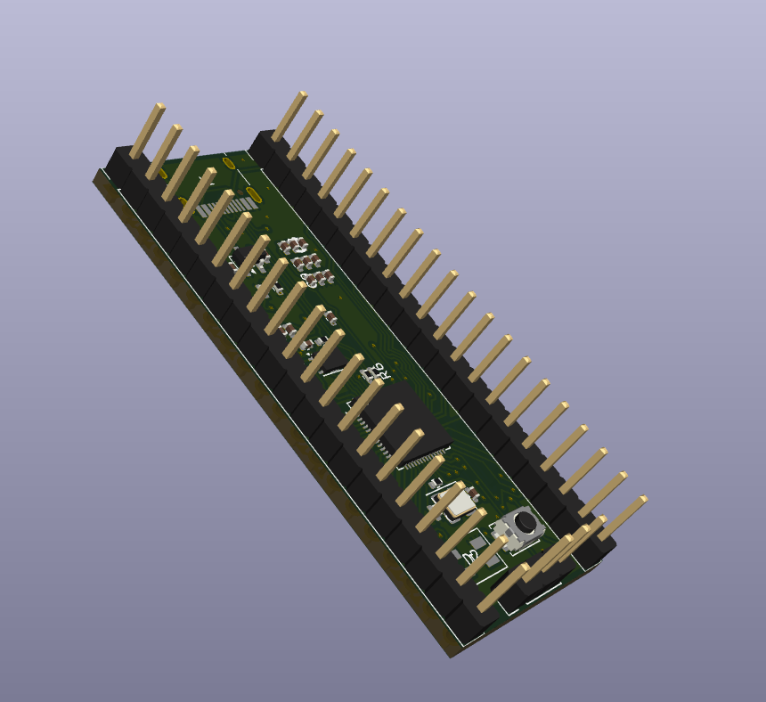
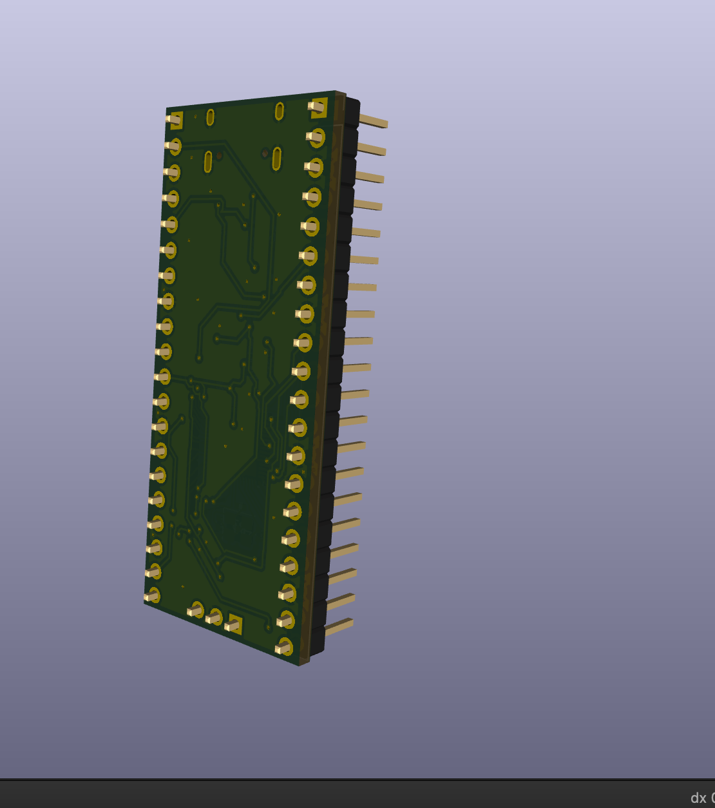
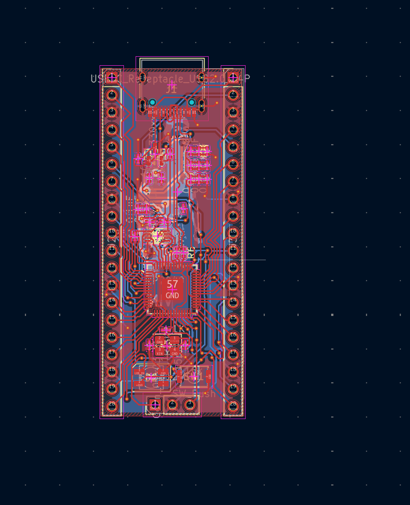

# RP2040 Custom PCB

## Overview

This project is a custom development board that uses the RP2040 microcontroller. It is designed to be small and easily programmable for electronics and embedded projects.

The board comprises a USB-C connection, external flash memory, 3.3v voltage regulater and headers.

## How It Works

The RP2040 acts as the main controller for the board. It will run the programme stored on the external flash memory.

The USB-C connection allows the board to connect to USB. The voltage regulator provides the necessary 3.3v for the board to operate. The crystal oscillator provides the clock signal and the headers can be used to connect sensors, LEDs, buttons and other modules.

## Images

### 3D PCB Design

### PCB Routing

## Programming

The RP2040 can be programmed using RP2040 development environments such as the Arduino IDE or MicroPython.

The demonstration programme included with this project is a simple GPIO programme. This can be used to confirm that the microcontroller is working and controlling the external LED.

## PCB Files

All the files for designing this PCB were created using KiCad. These include the PCB.

## Bill of Materials (BOM)

| Component Name | Quantity | Product Link | Price |
|---|---:|---|---:|
| 1uF 0402 Capacitor | 2 | [LCSC](https://www.lcsc.com/product-detail/C52923.html) | $0.0064 |
| 0.1uF 0402 Capacitor | 11 | [LCSC](https://www.lcsc.com/product-detail/C1525.html) | $0.0035 |
| 10uF Capacitor | 2 | [LCSC](https://www.lcsc.com/product-detail/C19702.html) | $0.0065 |
| 15pF 0402 Capacitor | 2 | [LCSC](https://www.lcsc.com/product-detail/C1548.html) | $0.0038 |
| SK6812MINI-E RGB LED | 1 | [LCSC](https://www.lcsc.com/product-detail/C5149201.html) | $0.0810 |
| USB-C Connector | 1 | [LCSC](https://www.lcsc.com/product-detail/C165948.html) | $0.1736 |
| 1x20 Pin Header | 2 | [LCSC](https://www.lcsc.com/product-detail/C5156618.html) | $0.0510 |
| 1x03 Pin Header | 1 | [LCSC](https://www.lcsc.com/product-detail/C49257.html) | $0.0286 |
| 5.1k Resistor | 2 | [LCSC](https://www.lcsc.com/product-detail/C25905.html) | $0.0023 |
| 1k Resistor | 2 | [LCSC](https://www.lcsc.com/product-detail/C11702.html) | $0.0013 |
| 10k Resistor | 1 | [LCSC](https://www.lcsc.com/product-detail/C25744.html) | $0.0011 |
| 27 Ohm Resistor | 2 | [LCSC](https://www.lcsc.com/product-detail/C25100.html) | $0.0013 |
| Push Button | 1 | [LCSC](https://www.lcsc.com/product-detail/C720477.html) | $0.0505 |
| RP2040 Microcontroller | 1 | [LCSC](https://www.lcsc.com/product-detail/C2040.html) | $1.0969 |
| MCP1700T-3302E/TT Voltage Regulator | 1 | [LCSC](https://www.lcsc.com/product-detail/C39051.html) | $0.4821 |
| W25Q16JVUXIQ Flash Memory | 1 | [LCSC](https://www.lcsc.com/product-detail/C2843335.html) | $1.6539 |
| 12MHz Crystal | 1 | [LCSC](https://www.lcsc.com/product-detail/C9002.html) | $0.0963 |
| **Total** | | | **$3.8477** |

